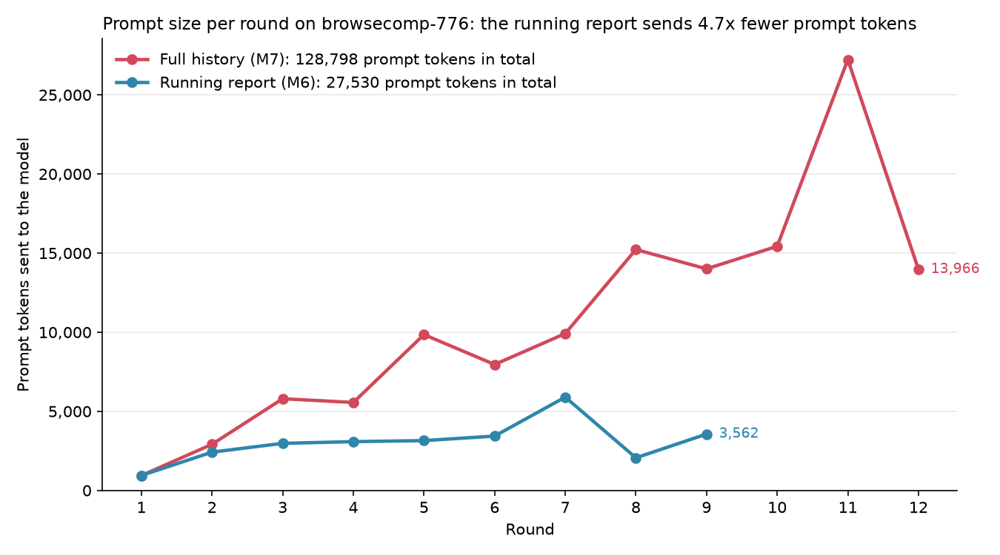

# Research Agent

A web research agent built with LangGraph and served by LangGraph Server.

Most research agents append every search result to the prompt, so each round costs
more than the last. This agent rebuilds its workspace every round from three things:
the question, an evolving report, and the last step. The prompt stays flat however
many rounds a run takes.

## Results

- **95% on FRAMES at $0.0019 per question.** 19 of 20 questions, `zai-org/GLM-5.3-Flash`,
  subset seed 0. Twenty questions is a demonstration, not a benchmark score.
- **3.9 times smaller prompt.** On one BrowseComp question, at round 8, the full-history
  arm sends 14,005 prompt tokens and the evolving report sends 3,562.
- **Trace:** [a passing FRAMES run](https://smith.langchain.com/public/635c6443-0c07-4fb4-b128-ffdadd18d845/r).
  A failing run's trace is not published yet.

Live-web scores can run up to 4 points high, because the agent can find benchmark
answers online (arXiv 2606.05241).

## How it works

```
question → think → act → think → act → … → answer
```

- `think` reads the workspace, rewrites the report, and picks one action as
  structured output: search, look up pages, or answer.
- `act` runs that action as a batch. Searches go to Tavily. Look-ups fetch each page
  and summarise it against the current goal with a cheaper model.
- The loop ends on an answer or at the round limit. A run that hits the limit
  still answers from its report, and `stop_reason` says why it stopped.

## Engineering

- **Provider-agnostic.** Every model goes through one OpenAI-compatible factory. The
  endpoint in the environment picks the provider. The `think` and `look_up` roles
  can use different models.
- **Token-metered.** Every model call's input and output tokens are read from the
  response and carried in graph state, so each run reports its own usage.
- **Resilient.** Rate limits, transient network errors and malformed model output
  each have their own retry budget. Only transport errors back off, with jitter and
  `Retry-After`.
- **Safe tools.** URL look-ups refuse private, loopback and link-local addresses.
  Every tool result and error message is capped before it reaches a prompt.
- **Scoped API.** A JWT auth handler stamps each thread and run with its owner and
  filters reads by it. Callers can lower limits per run but never raise them.
- **Traced.** Runs go to LangSmith, tagged with model and ablation arm.

## Layout

```
backend/
  langgraph.json              # registers each graph with LangGraph Server
  src/core/                   # shared: settings, model factory, tokens, retry, auth, tools
  src/agents/research_agent/  # graph.py wires, nodes.py holds the logic
  tests/unit/                 # each node called as a plain function, mocked model
  tests/integration/          # the compiled graph, network mocked
  tests/structure/            # ast checks that enforce the layout and import rules
  evals/research_agent/       # benchmark runner, judges, golden set, safety evals
  loadtest/                   # server load test against a fake model and fake search
docs/                         # charts built from eval results
```

Adding an agent means adding one package under `src/agents/` and one line in
`langgraph.json`.

## Run it

Requires Python 3.13 and [uv](https://docs.astral.sh/uv/).

```bash
cd backend
uv sync
```

Create `backend/.env`:

```env
ENVIRONMENT=development
BASE_URL=https://your-openai-compatible-endpoint/v1
LLM_API_KEY=your-key
THINK_MODEL=your-model
LOOK_UP_MODEL=your-cheaper-model
TAVILY_API_KEY=your-tavily-key
```

```bash
uv run langgraph dev --no-browser
```

The server listens on `http://127.0.0.1:2024` and serves the assistant
`research_agent`:

```python
from langgraph_sdk import get_client

client = get_client(url="http://127.0.0.1:2024")
thread = await client.threads.create()
async for chunk in client.runs.stream(
    thread["thread_id"], "research_agent",
    input={"question": "Which company acquired Windsurf in 2025?"},
    stream_mode="updates",
):
    print(chunk.data)
```

## Evaluate it

The eval runner calls the real provider and Tavily, so every run costs money.
`--budget-usd` stops it before it starts a question past the limit.

```bash
cd backend
uv run python -m evals.research_agent.run --benchmark frames --subset-size 20 --seed 0
ANSWER_STYLE=report uv run python -m evals.research_agent.run --benchmark golden --out results/golden.jsonl
```

`--benchmark` takes `browsecomp`, `frames` or `golden`. The golden set is 30 FRAMES
questions, each graded against the facts it must contain and the wrong claims it must
not make. Each question writes one
JSON line with its verdict, rounds, tokens, dollars and per-round prompt size. A second
pass over the same `--out` file skips finished questions.

`docs/m7_prompt_tokens.png` compares prompt tokens per round on one BrowseComp
question. The running report stays near 3,000 tokens a round. Full history climbs to
over 13,000.



## When things go wrong

- **Load.** `backend/loadtest/` runs LangGraph Server in Docker against a fake model
  and fake Tavily, then checks the speed targets in `SLO.md`. At 50 users it served
  545 runs a minute with a 1.5 s p95 time to first token.
- **Prompt injection.** `backend/evals/research_agent/injection.py` serves pages with
  hidden instructions. 0 of 29 exposed cases changed what the agent did.
- **Jailbreaks.** `backend/evals/research_agent/jailbreak.py` sends 300 JailbreakBench
  prompts and grades each answer with a judge. It is built and tested, but not yet run
  against a real model.
- **Release gate.** `run.py --gate` fails when the golden set pass rate drops more than
  10 points below `baseline.json`, which holds 29 of 30. The `Golden gate` workflow
  runs it by hand only, because every run costs money.

## Checks

```bash
uv run pytest
uv run ruff check .
uv run mypy src
```

CI runs all three on every push. mypy runs in strict mode.
